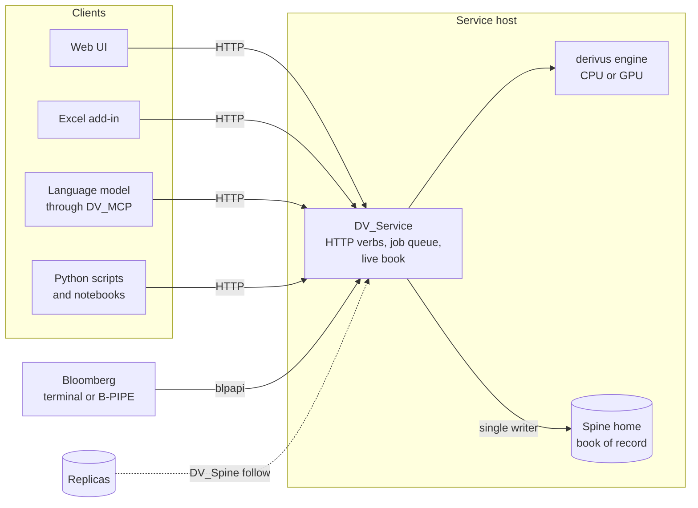

# Derivus

Derivus values portfolios of derivatives and simulates them through time, on CPUs or NVIDIA GPUs,
to give a trading desk, a risk function and an xVA desk their numbers from one engine: marks,
exposure profiles, CVA and FVA, and the sensitivities of each. Every sensitivity comes from
automatic differentiation, carried back through the library's own calibrations to the market quotes
a desk trades on. Curves, volatility surfaces and model parameters are calibrated inside the library,
by the same pricers that value the book. A quoting desk runs over it as an HTTP service that people,
spreadsheets and a language model drive through the same verbs, and a book of record, the spine,
keeps every booking, market and close the engine prices against.

## Who it is for

Dealers that quote, book and carry counterparty risk on an over-the-counter derivatives book: the
front office, the xVA desk, market and credit risk, product control and model validation. In a
bank's stack these functions usually run on separate systems that reconcile against each other: a
pricing library, a curve and volatility construction tool, an exposure and xVA engine, a
sensitivity feed for initial margin, and the trade store they all read. Derivus is one engine, one
job format and one record for all of them, so a desk's mark and the xVA desk's exposure come from
the same model of the same trade on the same market. The source is open to read, so a validator reads the code that produced a
number beside the theory that specifies it.

The engine is also a Python library: a script can load a job document and run it in process with
no service at all. [Deployment and Operations](deployment.md) describes each box in the diagram.

## What it covers

| | |
| --- | --- |
| **Products** | *Rates:* deposits, FRAs, swaps, caps, floors, swaptions, fixed and floating cashflow lists. *FX:* forwards, non-deliverable forwards, FX swaps, mark-to-market cross-currency swaps, vanilla, binary, touch, barrier, partial-time barrier and Asian options, target redemption forwards, accumulators, extendable forwards. *Equity:* shares, forwards, equity swaps, vanilla, binary, touch, barrier and Asian options, autocallable swaps. *Commodity and energy:* fixed and floating energy swaps, average-price swaps, forwards, futures, energy, digital and touch options. *Inflation:* inflation-linked cashflow lists. *Credit:* credit default swaps, nth-to-default baskets. *Structures:* netting sets with their collateral agreements, deals holding other deals, and seven declared FX sales structures (straddle, strangle, zero-cost collar, seagull, forward extra, target redemption forward, accumulator) quoted two-way and solved in the service. |
| **Models** | *Spot:* geometric Brownian motion (constant or term-structure implied), log Ornstein-Uhlenbeck, hidden-Markov regime switching, GARCH, basis-linked spot. *Rates:* Hull-White one- and two-factor, principal-component curves; Hull-White hazard rates for credit. *Commodity:* Clewlow-Strickland forward curves, quadratic carry curves, chained basis, fixing bridge. *Stochastic volatility:* LogVar2FJ, a two-factor log-variance model whose one parameter set prices path-dependent equity and FX options, generates spot scenarios and fits European and forward-start smiles. |
| **Calibration** | Inside the library, from market quotes: zero curves from deposit, FRA, swap and FX-forward quotes; FX volatility surfaces from ATM, risk-reversal and butterfly quotes; Hull-White two-factor from at-the-money swaptions; LogVar2FJ from European options and forward-start smiles; Clewlow-Strickland from energy futures options. The simulation models also fit to history. |
| **Measures** | Mark-to-market and cashflows. Exposure profiles (expected positive and negative exposure, potential future exposure at chosen percentiles) from a full-portfolio Monte Carlo through time, collateralised or not. CVA and FVA per netting set, with their gradients. ISDA SIMM sensitivities written as a CRIF, and the margin aggregated off it. The SA-CCR exposure at default per netting set. First- and second-order greeks by automatic differentiation. Quote-space risk: first-order sensitivities to the market quotes behind the curves, the FX smiles and the Hull-White and LogVar2FJ calibrations, beside those to the calibrated factors. |
| **Operations** | Validate before write: a booking, amendment or market update lands only when the engine has nothing against it, and a refusal returns the engine's own message. Replay identity: a run is named by its plan, its market values, the engine version and its seed, so the same submission is one execution and one result. A record: bookings, market declarations, official closes, approvals and attested runs are appended to the spine, chained, sealed and never edited, and positions, P&L, cash, collateral calls and the settlement diary are derived from it. |

## What is ready and what is not

The base valuation and the credit Monte Carlo - marks, exposure, CVA and FVA - are mature: they
are the production valuation paths every other part of the library reconciles against. The
hedging stack is being refined and extended, and its simulation (`HedgeMonteCarlo`) and solver are
where the research is; a job stays a JSON document whatever changes behind it, and the MCP binding
carries a client across, so that work changes no interface. One part is not at the production
standard: the collateral valuation adjustment (CollVA) and the initial margin add-on in the credit
Monte Carlo's xVA block are experimental and stay undocumented until they are fixed. Do not rely on
their numbers.

Everything known to be wrong or limited elsewhere is listed on [Model Limitations](limitations.md).

## Where next

- [Getting Started](getting_started.md): from an install to a working desk.
- [Deployment and Operations](deployment.md): the components, the files, security, backup and
  hardware, for whoever runs it.
- [Validating Derivus](validating.md): running the test suite and reading what each test holds.
- The [Theory](theory/definitions.md) and [Valuation](valuation/definitions.md) pages: each model
  and pricer as a validator reads it, with [xVA](theory/valuation_adjustments.md) on its own page.
- [JSON Configuration](json/index.md): every block of a job document.

## Licence

Derivus is free for **noncommercial** use under the
[PolyForm Noncommercial License 1.0.0](https://polyformproject.org/licenses/noncommercial/1.0.0):
research, personal projects, education and evaluation are all in scope, and the source is open to
read, run and validate. Commercial use requires a separate licence, and a ninety-day commercial
evaluation is available beside it ([LICENSE](https://github.com/sylam/derivus/blob/main/LICENSE));
for either, contact the author.
